<div align="center">
  <table>
    <tr>
      <td align="center" valign="middle">
        
      </td>
      <td align="center" valign="middle">
        <strong>INSTITUTO POLITÉCNICO NACIONAL</strong><br>
        <strong>ESCUELA SUPERIOR DE CÓMPUTO</strong><br><br>
        Ingeniería en Inteligencia Artificial<br>
        Grupo: 3BM2 &nbsp;|&nbsp; Semestre: 2027-1<br>
        Docente: Morales Rodriguez Ursula Samantha
      </td>
      <td align="center" valign="middle">
        
      </td>
    </tr>
  </table>
</div>

<div align="center">

# Casos de Prueba — Arquitecto de Ecosistemas

</div>

<div align="justify">

**Proyecto:** Sistema experto en Prolog para evaluar la convivencia de especies en un mismo hábitat.  

**Alcance:** 10 escenarios de prueba sobre la base de conocimientos de 24 especies, ejecutados en tres niveles (motor de Prolog, API e interfaz web), más pruebas de validación de la API.  

**Tipo de pruebas:** Caja negra (entrada → veredicto esperado)

## Criterios de referencia usados para los resultados esperados

Los resultados esperados de este documento se calcularon con los siguientes criterios, que son los mismos que implementan `hechos.pl` y `reglas.pl`:

* **Ejemplares:** Se introduce **un ejemplar adulto por especie**, salvo que se indique otra cosa.
* **Temperatura:** Las especies son compatibles si sus rangos `temp_min`–`temp_max` tienen intersección. La temperatura de operación del hábitat es esa intersección.
* **pH:** Misma lógica de intersección. Un valor `na` significa "no aplica" (especie terrestre pura) y se ignora.
* **Humedad:** Misma lógica de intersección. Un valor `na` significa "no aplica" (especie acuática pura) y se ignora.
* **Capacidad del tanque:** Se expresa con la misma unidad que usa cada hábitat: **litros** (`litros`) en acuarios, **centímetros cuadrados** (`cm2`) en terrarios y **ambos valores** (`litros_y_cm2`) en paludarios.
* **Espacio:** El sistema extrae el valor numérico de los functores (`litros`, `cm2` o `litros_y_cm2`) de cada especie y suma por separado los litros y los cm² requeridos. Hay hacinamiento si los litros requeridos superan los litros del tanque **o** si los cm² requeridos superan los cm² del tanque.
* **Depredación:** Hay conflicto cuando una especie `depredador` comparte hábitat con otra cuyo `tamano_max_cm` es menor o igual al **50 %** del tamaño del depredador (cabe en su boca).
* **Territorialidad y agresión:** Hay conflicto cuando dos especies `territorial` comparten el mismo espacio, o cuando cualquiera de las dos es `agresivo`.
* **Compatibilidad de hábitat:** Un acuario acepta solo especies `acuatico`, un terrario tropical, solo `terrestre_tropical`, un terrario desértico, solo `terrestre_desertico`, y un paludario acepta `mixto`, `terrestre_tropical` y `acuatico`.
* **Tipos de tanque:** acuario = hábitat `acuatico`, terrario = hábitat `terrestre_tropical` o `terrestre_desertico`, paludario = hábitat `mixto`.

## Resumen de casos

| # | Nombre | Categoría | Veredicto esperado |
|---|--------|-----------|--------------------|
| 1 | Acuario comunitario de especies pequeñas | Viable | Ecosistema viable |
| 2 | Terrario tropical húmedo | Viable | Ecosistema viable |
| 3 | Paludario con zona acuática y terrestre | Viable | Ecosistema viable |
| 4 | Óscar y guppy | Depredación | Conflicto biológico |
| 5 | Ajolote y camarón cereza | Depredación | Conflicto biológico |
| 6 | Betta y cíclido convicto | Agresión / territorialidad | Conflicto biológico |
| 7 | Uromastyx y anolis verde | Hábitat / humedad | Incompatibilidad de parámetros |
| 8 | Iguana verde y salamandra tigre | Temperatura | Incompatibilidad de parámetros |
| 9 | Acuario comunitario sobrepoblado | Hacinamiento | Espacio insuficiente |
| 10 | Terrario desértico reducido | Hacinamiento | Espacio insuficiente |

### Caso de Prueba 1: Acuario comunitario de especies pequeñas
* **Objetivo:** Verificar que el sistema acepta un ecosistema acuático con varias especies pacíficas cuyos rangos de temperatura y pH se cruzan en una franja estrecha, y que calcula correctamente los parámetros de operación del tanque.
* **Entrada Simulada:**
  * Especies: `pez_guppy`, `tetra_neon`, `corydora`, `camaron_cereza` (1 ejemplar de cada una).
  * Tipo de hábitat del tanque: `acuatico` (acuario).
  * Tamaño: 200 litros (por ejemplo, 100 × 40 × 50 cm).
* **Resultado Lógico Esperado:** **Ecosistema viable.**
  * Temperatura común: 22–26 °C (límite inferior del guppy y la corydora, límite superior del tetra y la corydora).
  * pH común: 6.8–7.0 (límite inferior del guppy, límite superior del tetra neón). La franja es estrecha pero existe.
  * Espacio: Requiere 140 L (20 + 40 + 60 + 20) y el tanque ofrece 200 L.
  * Temperamento: Las cuatro especies son `pacifico` y la más grande mide 7 cm, así que no hay riesgo de depredación ni territorialidad.

**Ejecución del caso**

*Nivel 1: Motor (Prolog)*:

```prolog
E = [pez_guppy, tetra_neon, corydora, camaron_cereza], T = tanque(acuatico, litros(200)), diagnostico(E, T, C), (ecosistema_viable(E, T) -> V = viable ; V = no_viable).
```

Respuesta esperada: `C = []`, `V = viable`.

*Nivel 2: API*, cuerpo del `POST` a `/api/evaluar` (`post '<cuerpo>'`):

```json
{"especies":["pez_guppy","tetra_neon","corydora","camaron_cereza"],"tanque_tipo":"acuatico","tanque_capacidad":200}
```

Respuesta esperada: HTTP 200 con `"viable": true` y `"conflictos": []`.

*Nivel 3: Interfaz web:* Ecosistema: Acuático (Acuario). Capacidad: 200 L. Especies: Pez Guppy, Tetra Neón, Corydora y Camarón Cereza.  
Resultado: mensaje central "Ecosistema Viable" (verde) y un monitor principal "Ecosistema estable" con 0 conflictos.

> **Evidencia (motor Prolog):**  
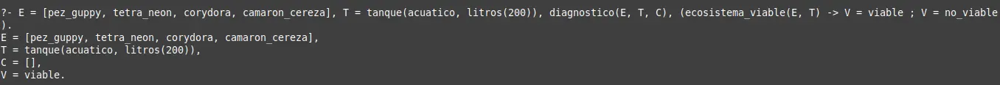

>
> **Evidencia (API, opcional):**  
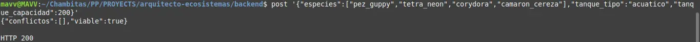

>
> **Evidencia (interfaz web):**  
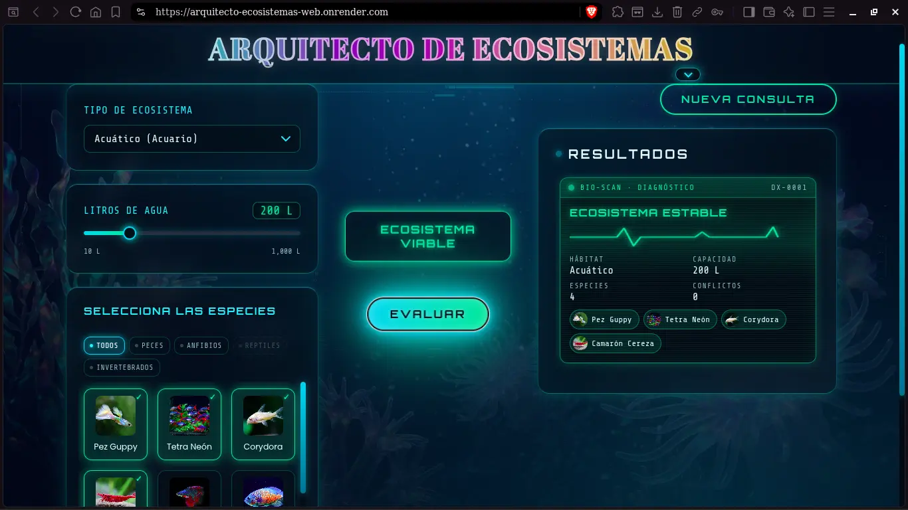

### Caso de Prueba 2: Terrario tropical húmedo
* **Objetivo:** Verificar que el sistema acepta un terrario con especies terrestres tropicales de distinta clase (anfibio y reptil) y que ignora el pH (valor `na`) al evaluar especies terrestres puras.
* **Entrada Simulada:**
  * Especies: `rana_ojos_rojos`, `gecko_crestado` (1 ejemplar de cada una).
  * Tipo de hábitat del tanque: `terrestre_tropical` (terrario).
  * Tamaño: 5,000 cm² de superficie (por ejemplo, base de 100 × 50 cm).
* **Resultado Lógico Esperado:** **Ecosistema viable.**
  * Temperatura común: 22–27 °C.
  * Humedad común: 70–80 %.
  * pH: No se evalúa, porque ambas especies tienen `na`.
  * Espacio: Requiere 2,050 cm² (1,300 + 750) y el terrario ofrece 5,000 cm².
  * Temperamento: Ambas son `pacifico`.

**Ejecución del caso**

*Nivel 1: Motor (Prolog)*

```prolog
E = [rana_ojos_rojos, gecko_crestado], T = tanque(terrestre_tropical, cm2(5000)), diagnostico(E, T, C), (ecosistema_viable(E, T) -> V = viable ; V = no_viable).
```

Respuesta esperada: `C = []`, `V = viable`.

*Nivel 2: API*, cuerpo del `POST` a `/api/evaluar` (`post '<cuerpo>'`):

```json
{"especies":["rana_ojos_rojos","gecko_crestado"],"tanque_tipo":"terrestre_tropical","tanque_capacidad":5000}
```

Respuesta esperada: HTTP 200 con `"viable": true` y `"conflictos": []`.

*Nivel 3: Interfaz web:* Ecosistema: Terrestre Tropical. Área: 5,000 cm². Especies: Rana Ojos Rojos y Gecko Crestado.  
Resultado: "Ecosistema Viable" (verde) y un monitor principal "Ecosistema estable" con 0 conflictos.

> **Evidencia (motor Prolog):**  


>
> **Evidencia (API, opcional):**  
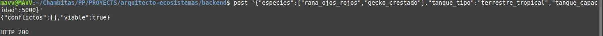

>
> **Evidencia (interfaz web):**  
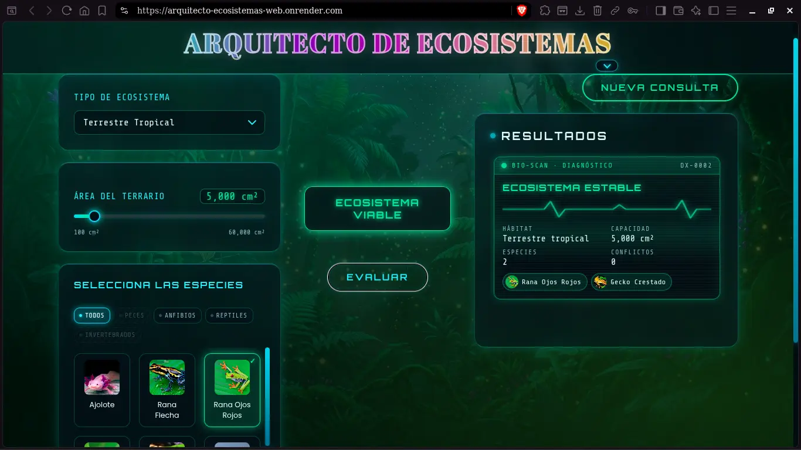

### Caso de Prueba 3: Paludario con zona acuática y terrestre
* **Objetivo:** Verificar el manejo de una especie de hábitat `mixto` (que exige pH y humedad) combinada con una especie acuática pura (humedad `na`), validando que cada parámetro se evalúa solo donde aplica.
* **Entrada Simulada:**
  * Especies: `sapo_vientre_fuego`, `corydora` (1 ejemplar de cada una).
  * Tipo de hábitat del tanque: `mixto` (paludario).
  * Tamaño: zona acuática de 150 litros y zona terrestre de 2,000 cm².
* **Resultado Lógico Esperado:** **Ecosistema viable.**
  * Temperatura común: 22–24 °C (límite inferior de la corydora, límite superior del sapo).
  * pH común: 6.5–7.5 en la zona acuática.
  * Humedad: 60–80 %, exigida solo por el sapo; la corydora tiene `na` y no aplica.
  * Espacio: Requiere 100 L (40 + 60) y 400 cm² (solo el sapo usa zona terrestre); el paludario ofrece 150 L y 2,000 cm².
  * Hábitat: El paludario acepta tanto una especie `mixto` como una `acuatico`.
  * Temperamento: Ambas son `pacifico` y ninguna es depredadora, así que no hay riesgo de depredación.

**Ejecución del caso**

*Nivel 1: Motor (Prolog)*

```prolog
E = [sapo_vientre_fuego, corydora], T = tanque(mixto, litros_y_cm2(150, 2000)), diagnostico(E, T, C), (ecosistema_viable(E, T) -> V = viable ; V = no_viable).
```

Respuesta esperada: `C = []`, `V = viable`.

*Nivel 2: API*, cuerpo del `POST` a `/api/evaluar` (`post '<cuerpo>'`):

```json
{"especies":["sapo_vientre_fuego","corydora"],"tanque_tipo":"mixto","tanque_capacidad":{"litros":150,"area":2000}}
```

Respuesta esperada: HTTP 200 con `"viable": true` y `"conflictos": []`.

*Nivel 3: Interfaz web:* Ecosistema: Mixto (Paludario). Litros: 150 L y área de tierra: 2,000 cm². Especies: Sapo Vientre Fuego y Corydora.  
Resultado: "Ecosistema Viable" (verde) y un monitor principal "Ecosistema estable" con 0 conflictos.

> **Evidencia (motor Prolog):**  
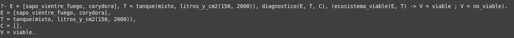

>
> **Evidencia (API, opcional):**  
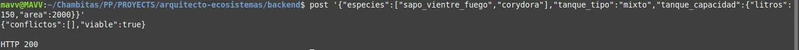

>
> **Evidencia (interfaz web):**  
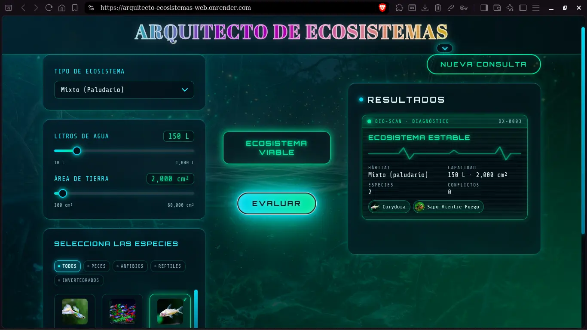

### Caso de Prueba 4: Óscar y guppy
* **Objetivo:** Verificar que el sistema detecta un conflicto de depredación cuando un pez grande comparte tanque con uno que cabe en su boca, aunque temperatura, pH y espacio sean compatibles.
* **Entrada Simulada:**
  * Especies: `pez_oscar`, `pez_guppy` (1 ejemplar de cada una).
  * Tipo de hábitat del tanque: `acuatico` (acuario).
  * Tamaño: 600 litros (por ejemplo, 180 × 60 × 55 cm).
* **Resultado Lógico Esperado:** **Conflicto biológico (depredación).**
  * El óscar es `depredador` y alcanza 35 cm; el guppy es `pacifico` y mide 6 cm, que es menor al 50 % del tamaño del óscar (17.5 cm), por lo que es presa potencial.
  * Los demás parámetros sí son compatibles (temperatura 22–28 °C, pH 6.8–7.5, espacio 420 L requeridos de 600 L disponibles). El único motivo del rechazo se debe a la depredación.
  * Biológicamente, el óscar es un cíclido carnívoro oportunista que se alimenta de peces pequeños.

**Ejecución del caso**

*Nivel 1: Motor (Prolog)*

```prolog
E = [pez_oscar, pez_guppy], T = tanque(acuatico, litros(600)), diagnostico(E, T, C), (ecosistema_viable(E, T) -> V = viable ; V = no_viable).
```

Respuesta esperada: `C = [conflicto('Riesgo de depredacion', involucrados(pez_oscar, pez_guppy))]`, `V = no_viable`.

*Nivel 2: API*, cuerpo del `POST` a `/api/evaluar` (`post '<cuerpo>'`):

```json
{"especies":["pez_oscar","pez_guppy"],"tanque_tipo":"acuatico","tanque_capacidad":600}
```

Respuesta esperada: HTTP 200 con `"viable": false` y un conflicto: `"Riesgo de depredacion"`, involucrados `["pez_oscar", "pez_guppy"]`.

*Nivel 3: Interfaz web:* Ecosistema: Acuático (Acuario). Capacidad: 600 L. Especies: Pez Oscar y Pez Guppy.  
Resultado: "Conflictos Encontrados" (rojo), un monitor principal "Ecosistema no viable" y un monitor de alerta "Depredación".

> **Evidencia (motor Prolog):**  
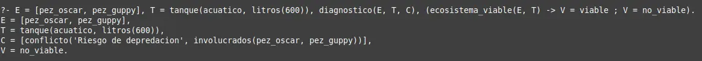

>
> **Evidencia (API, opcional):**  
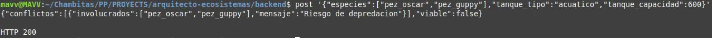

>
> **Evidencia (interfaz web):**  
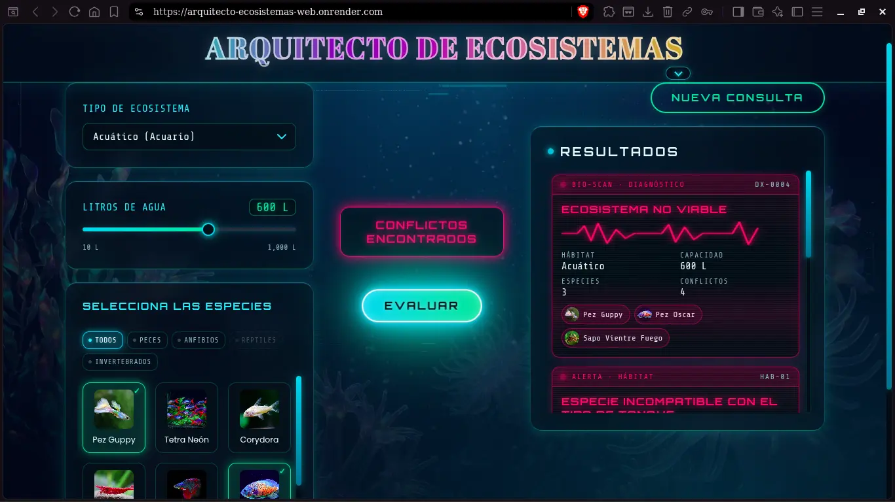

### Caso de Prueba 5: Ajolote y camarón cereza
* **Objetivo:** Verificar que la detección de depredación funciona también con un anfibio acuático y un invertebrado, y que no depende de que ambos sean peces.
* **Entrada Simulada:**
  * Especies: `ajolote`, `camaron_cereza` (1 ejemplar de cada una).
  * Tipo de hábitat del tanque: `acuatico` (acuario).
  * Tamaño: 250 litros (por ejemplo, 100 × 50 × 50 cm).
* **Resultado Lógico Esperado:** **Conflicto biológico (depredación).**
  * El ajolote es `depredador` (hasta 30 cm) y el camarón cereza es `pacifico` (4 cm, menor al 50 % del tamaño del ajolote, es decir 15 cm), presa potencial.
  * Los parámetros sí se cruzan (temperatura 18–20 °C, pH 6.5–8.0, espacio 170 L requeridos de 250 L disponibles). El rechazo se debe solo a la depredación.
  * Biológicamente, el ajolote es carnívoro y captura con succión cualquier presa pequeña que encuentre.

**Ejecución del caso**

*Nivel 1: Motor (Prolog)*

```prolog
E = [ajolote, camaron_cereza], T = tanque(acuatico, litros(250)), diagnostico(E, T, C), (ecosistema_viable(E, T) -> V = viable ; V = no_viable).
```

Respuesta esperada: `C = [conflicto('Riesgo de depredacion', involucrados(ajolote, camaron_cereza))]`, `V = no_viable`.

*Nivel 2: API*, cuerpo del `POST` a `/api/evaluar` (`post '<cuerpo>'`):

```json
{"especies":["ajolote","camaron_cereza"],"tanque_tipo":"acuatico","tanque_capacidad":250}
```

Respuesta esperada: HTTP 200 con `"viable": false` y un conflicto: `"Riesgo de depredacion"`, involucrados `["ajolote", "camaron_cereza"]`.

*Nivel 3: Interfaz web:* Ecosistema: Acuático (Acuario). Capacidad: 250 L. Especies: Ajolote y Camarón Cereza.  
Resultado: "Conflictos Encontrados" (rojo), un monitor principal "Ecosistema no viable" y un monitor de alerta "Depredación".

> **Evidencia (motor Prolog):**  
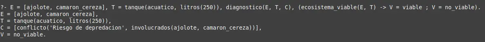

>
> **Evidencia (API, opcional):**  
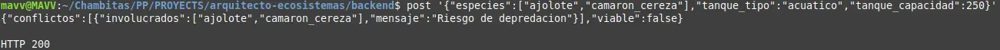

>
> **Evidencia (interfaz web):**  
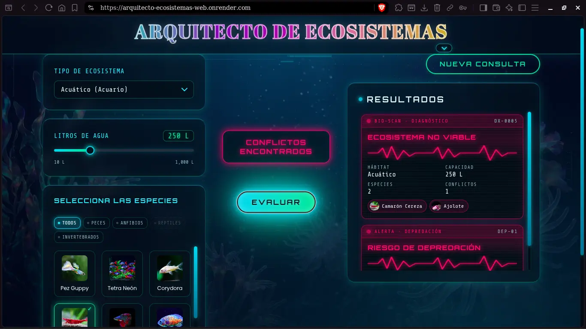

### Caso de Prueba 6: Betta y cíclido convicto
* **Objetivo:** Verificar que el sistema detecta un conflicto por agresión o territorialidad entre un pez territorial y uno agresivo, aunque el tanque sea amplio y los parámetros coincidan.
* **Entrada Simulada:**
  * Especies: `pez_betta`, `ciclido_convicto` (1 ejemplar de cada una).
  * Tipo de hábitat del tanque: `acuatico` (acuario).
  * Tamaño: 300 litros (por ejemplo, 120 × 50 × 50 cm).
* **Resultado Lógico Esperado:** **Conflicto biológico (agresión / territorialidad).**
  * El betta es `territorial` y el cíclido convicto es `agresivo`. El sistema marca conflicto cuando cualquiera de las dos especies es `agresivo`. El convicto (15 cm) es más grande que el betta (7 cm), así que el betta saldría perjudicado.
  * Los demás parámetros son compatibles (temperatura 24–28 °C, pH 6.5–7.5, espacio 170 L requeridos de 300 L disponibles). El rechazo se debe solo al temperamento.

**Ejecución del caso**

*Nivel 1: Motor (Prolog)*

```prolog
E = [pez_betta, ciclido_convicto], T = tanque(acuatico, litros(300)), diagnostico(E, T, C), (ecosistema_viable(E, T) -> V = viable ; V = no_viable).
```

Respuesta esperada: `C = [conflicto('Conflicto por agresion o territorialidad', involucrados(pez_betta, ciclido_convicto))]`, `V = no_viable`.

*Nivel 2: API*, cuerpo del `POST` a `/api/evaluar` (`post '<cuerpo>'`):

```json
{"especies":["pez_betta","ciclido_convicto"],"tanque_tipo":"acuatico","tanque_capacidad":300}
```

Respuesta esperada: HTTP 200 con `"viable": false` y un conflicto: `"Conflicto por agresion o territorialidad"`, involucrados `["pez_betta", "ciclido_convicto"]`.

*Nivel 3: Interfaz web:* Ecosistema: Acuático (Acuario). Capacidad: 300 L. Especies: Pez Betta y Cíclido Convicto.  
Resultado: "Conflictos Encontrados" (rojo), un monitor principal "Ecosistema no viable" y un monitor de alerta "Agresión / territorio".

> **Evidencia (motor Prolog):**  
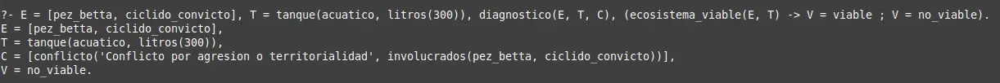

>
> **Evidencia (API, opcional):**  
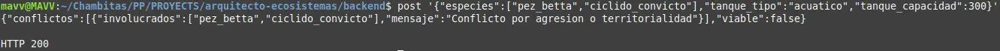

>
> **Evidencia (interfaz web):**  
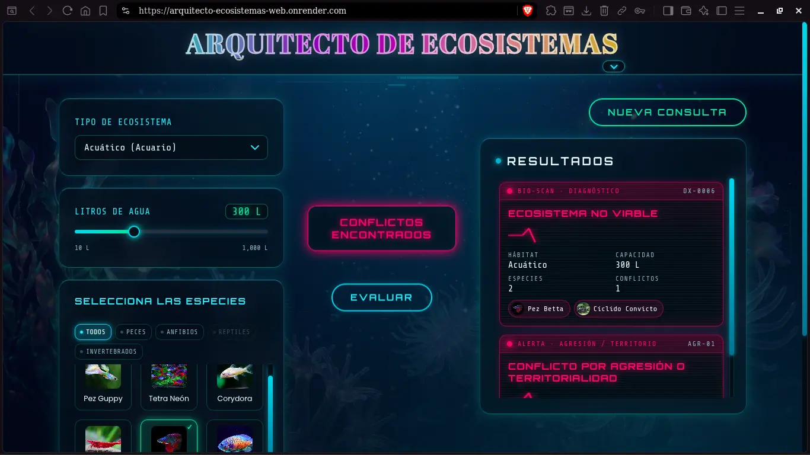

### Caso de Prueba 7: Uromastyx y anolis verde
* **Objetivo:** Verificar que el sistema rechaza la mezcla de una especie desértica con una tropical cuando la temperatura sí coincide pero la humedad no, y que además detecta que una de las especies no pertenece al hábitat del terrario.
* **Entrada Simulada:**
  * Especies: `uromastyx` (`terrestre_desertico`), `anolis_verde` (`terrestre_tropical`), 1 ejemplar de cada una.
  * Tipo de hábitat del tanque: `terrestre_desertico` (terrario desértico).
  * Tamaño: 9,000 cm² de superficie (por ejemplo, base de 150 × 60 cm).
* **Resultado Lógico Esperado:** **Incompatibilidad de parámetros (hábitat y humedad).**
  * Las temperaturas sí se cruzan (27–30 °C), por lo que ese parámetro no es el motivo del rechazo.
  * Humedad: El uromastyx requiere 10–20 % y el anolis 60–80 %. No hay intersección posible.
  * Hábitat: El anolis es `terrestre_tropical` y el terrario es `terrestre_desertico`, por lo que el sistema lo reporta como especie incompatible con el tipo de tanque.
  * El espacio alcanza (5,250 cm² requeridos de 9,000 cm² disponibles) y se evalúa un solo anolis, así que no hay conflicto de territorialidad.
  * Biológicamente, un uromastyx en humedad alta sufre problemas respiratorios y de piel; un anolis en ambiente árido se deshidrata.

**Ejecución del caso**

*Nivel 1: Motor (Prolog)*

```prolog
E = [uromastyx, anolis_verde], T = tanque(terrestre_desertico, cm2(9000)), diagnostico(E, T, C), (ecosistema_viable(E, T) -> V = viable ; V = no_viable).
```

Respuesta esperada: `C = [conflicto('Especie incompatible con el tipo de tanque', involucrados(anolis_verde)), conflicto('Incompatibilidad de pH o humedad', involucrados(uromastyx, anolis_verde))]`, `V = no_viable`.

*Nivel 2: API*, cuerpo del `POST` a `/api/evaluar` (`post '<cuerpo>'`):

```json
{"especies":["uromastyx","anolis_verde"],"tanque_tipo":"terrestre_desertico","tanque_capacidad":9000}
```

Respuesta esperada: HTTP 200 con `"viable": false` y **dos** conflictos: `"Especie incompatible con el tipo de tanque"` (`["anolis_verde"]`) e `"Incompatibilidad de pH o humedad"` (`["uromastyx", "anolis_verde"]`).

*Nivel 3: Interfaz web:* Ecosistema: Terrestre Desértico. Área: 9,000 cm². Especies: Uromastyx y Anolis Verde (ambos son reptiles, disponibles en la pestaña "Todos" y en "Reptiles").  
Resultado: "Conflictos Encontrados" (rojo), un monitor principal con 2 conflictos y dos monitores de alerta: "Hábitat" y "Químico".

> **Evidencia (motor Prolog):**  
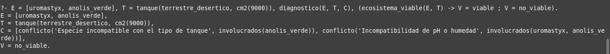

>
> **Evidencia (API, opcional):**  
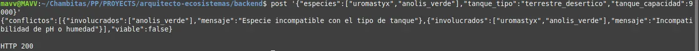

>
> **Evidencia (interfaz web):**  
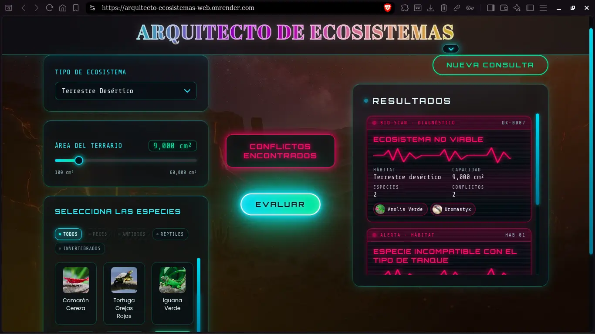

### Caso de Prueba 8: Iguana verde y salamandra tigre
* **Objetivo:** Verificar que el sistema detecta un choque de temperaturas (rangos sin intersección) aunque la humedad y el espacio sean compatibles.
* **Entrada Simulada:**
  * Especies: `iguana_verde` (`terrestre_tropical`), `salamandra_tigre` (`mixto`), 1 ejemplar de cada una.
  * Tipo de hábitat del tanque: `mixto` (paludario). Se usa un paludario porque acepta ambos hábitats; en un terrario tropical la salamandra (hábitat `mixto`) también sería rechazada por hábitat y el caso no aislaría la temperatura.
  * Tamaño: zona acuática de 200 litros y zona terrestre de 50,000 cm² (recinto de 250 × 200 cm de base).
* **Resultado Lógico Esperado:** **Incompatibilidad de parámetros (temperatura).**
  * La iguana requiere 24–32 °C y la salamandra 15–22 °C. Hay una brecha de 2 °C entre el máximo de la salamandra y el mínimo de la iguana, así que no existe una temperatura que sirva a ambas.
  * La humedad sí se cruza (70–80 %), el pH no se evalúa porque la iguana tiene `na`, y el espacio alcanza (75 L y 40,750 cm² requeridos de 200 L y 50,000 cm² disponibles). El rechazo se debe solo a la temperatura.
  * La salamandra es `depredador`, pero la iguana mide 180 cm y no es presa (el límite es 12.5 cm), así que no debe reportarse depredación.
  * Biológicamente, la salamandra tigre sufre estrés térmico por encima de unos 22 °C, mientras que la iguana necesita calor sostenido para digerir y regular su metabolismo.

**Ejecución del caso**

*Nivel 1: Motor (Prolog)*

```prolog
E = [iguana_verde, salamandra_tigre], T = tanque(mixto, litros_y_cm2(200, 50000)), diagnostico(E, T, C), (ecosistema_viable(E, T) -> V = viable ; V = no_viable).
```

Respuesta esperada: `C = [conflicto('Incompatibilidad de temperatura', involucrados(iguana_verde, salamandra_tigre))]`, `V = no_viable`.

*Nivel 2: API*, cuerpo del `POST` a `/api/evaluar` (`post '<cuerpo>'`):

```json
{"especies":["iguana_verde","salamandra_tigre"],"tanque_tipo":"mixto","tanque_capacidad":{"litros":200,"area":50000}}
```

Respuesta esperada: HTTP 200 con `"viable": false` y un conflicto: `"Incompatibilidad de temperatura"`, involucrados `["iguana_verde", "salamandra_tigre"]`.

*Nivel 3: Interfaz web:* Ecosistema: Mixto (Paludario). Litros: 200 L y área de tierra: 50,000 cm². Especies: Iguana Verde y Salamandra Tigre.  
Resultado: "Conflictos Encontrados" (rojo), un monitor principal "Ecosistema no viable" y un monitor de alerta "Temperatura".

> **Evidencia (motor Prolog):**  
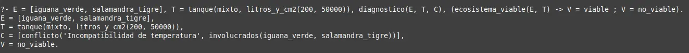

>
> **Evidencia (API, opcional):**  
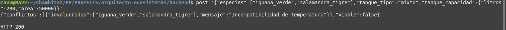

>
> **Evidencia (interfaz web):**  
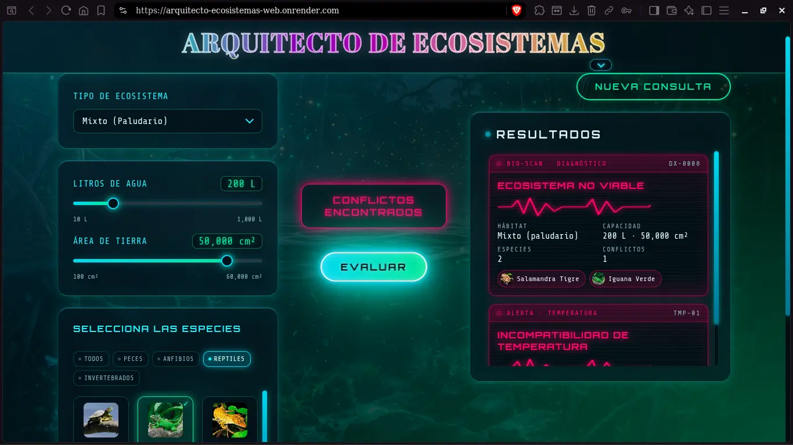

### Caso de Prueba 9: Acuario comunitario sobrepoblado
* **Objetivo:** Verificar que el sistema detecta hacinamiento por la suma de espacios mínimos cuando todas las especies son pacíficas y sus parámetros son compatibles.
* **Entrada Simulada:**
  * Especies: `goldfish`, `corydora`, `pez_guppy`, `tetra_neon` (1 ejemplar de cada una).
  * Tipo de hábitat del tanque: `acuatico` (acuario).
  * Tamaño: 100 litros (100 × 40 × 25 cm).
* **Resultado Lógico Esperado:** **Espacio insuficiente (hacinamiento).**
  * Requerido: 270 L (150 + 60 + 20 + 40). Disponible: 100 L, con un déficit de 170 L.
  * Los parámetros sí son compatibles (temperatura 22–24 °C, pH 6.8–7.0) y las cuatro especies son `pacifico`. El rechazo se debe solo al volumen.
  * Biológicamente, el goldfish adulto llega a 30 cm y produce mucho desecho; en poco volumen el amoníaco se acumula y estresa al resto de las especies.

**Ejecución del caso**

*Nivel 1: Motor (Prolog)*

```prolog
E = [goldfish, corydora, pez_guppy, tetra_neon], T = tanque(acuatico, litros(100)), diagnostico(E, T, C), (ecosistema_viable(E, T) -> V = viable ; V = no_viable).
```

Respuesta esperada: `C = [conflicto('Falta de espacio (Hacinamiento)', involucrados(todos))]`, `V = no_viable`.

*Nivel 2: API*, cuerpo del `POST` a `/api/evaluar` (`post '<cuerpo>'`):

```json
{"especies":["goldfish","corydora","pez_guppy","tetra_neon"],"tanque_tipo":"acuatico","tanque_capacidad":100}
```

Respuesta esperada: HTTP 200 con `"viable": false` y un conflicto: `"Falta de espacio (Hacinamiento)"`, involucrados `["todos"]`.

*Nivel 3: Interfaz web:* Ecosistema: Acuático (Acuario). Capacidad: 100 L. Especies: Goldfish, Corydora, Pez Guppy y Tetra Neón.  
Resultado: "Conflictos Encontrados" (rojo), un monitor principal "Ecosistema no viable" y un monitor de alerta "Espacio" (con "Todas las especies").

> **Evidencia (motor Prolog):**  
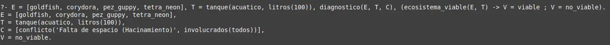

>
> **Evidencia (API, opcional):**  
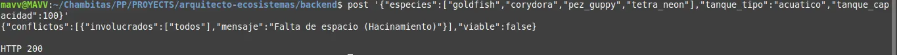

>
> **Evidencia (interfaz web):**  
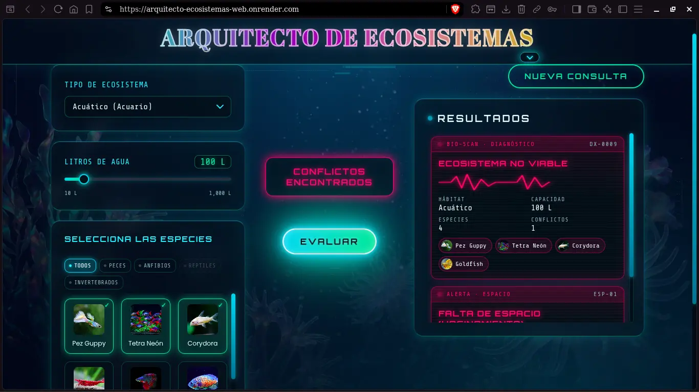

### Caso de Prueba 10: Terrario desértico reducido
* **Objetivo:** Verificar que el sistema detecta hacinamiento en un terrario, incluso cuando el área ya es insuficiente para la especie más exigente por sí sola.
* **Entrada Simulada:**
  * Especies: `dragon_barbudo`, `gecko_leopardo` (1 ejemplar de cada una).
  * Tipo de hábitat del tanque: `terrestre_desertico` (terrario).
  * Tamaño: 3,000 cm² de superficie (por ejemplo, base de 60 × 50 cm).
* **Resultado Lógico Esperado:** **Espacio insuficiente (hacinamiento).**
  * Requerido: 5,600 cm² (4,500 + 1,100). Disponible: 3,000 cm², con un déficit de 2,600 cm².
  * El dragón barbudo, por sí solo, ya requiere 4,500 cm², más de lo que ofrece el terrario.
  * Los parámetros sí son compatibles (temperatura 24–32 °C, humedad 30–40 %) y ambas especies son `pacifico`. El rechazo se debe solo al espacio.
  * Biológicamente, el espacio reducido impide crear el gradiente térmico (zona de asoleo y zona fría) que necesitan los reptiles desérticos para termorregular.

**Ejecución del caso**

*Nivel 1: Motor (Prolog)*

```prolog
E = [dragon_barbudo, gecko_leopardo], T = tanque(terrestre_desertico, cm2(3000)), diagnostico(E, T, C), (ecosistema_viable(E, T) -> V = viable ; V = no_viable).
```

Respuesta esperada: `C = [conflicto('Falta de espacio (Hacinamiento)', involucrados(todos))]`, `V = no_viable`.

*Nivel 2: API*, cuerpo del `POST` a `/api/evaluar` (`post '<cuerpo>'`):

```json
{"especies":["dragon_barbudo","gecko_leopardo"],"tanque_tipo":"terrestre_desertico","tanque_capacidad":3000}
```

Respuesta esperada: HTTP 200 con `"viable": false` y un conflicto: `"Falta de espacio (Hacinamiento)"`, involucrados `["todos"]`.

*Nivel 3: Interfaz web:* Ecosistema: Terrestre Desértico. Área: 3,000 cm². Especies: Dragón Barbudo y Gecko Leopardo.  
Resultado: "Conflictos Encontrados" (rojo), un monitor principal "Ecosistema no viable" y un monitor de alerta "Espacio" (con "Todas las especies").

> **Evidencia (motor Prolog):**  
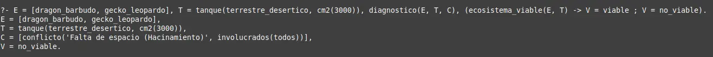

>
> **Evidencia (API, opcional):**  
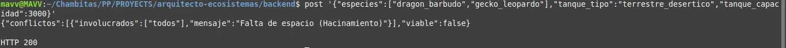

>
> **Evidencia (interfaz web):**  
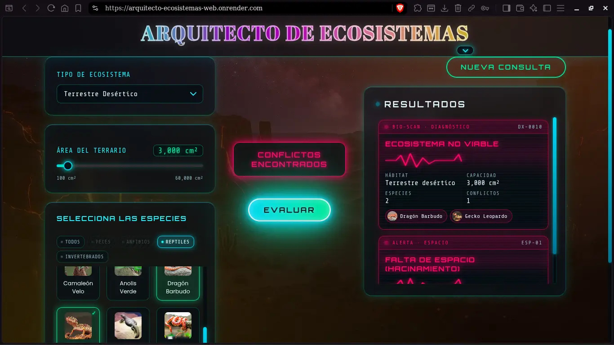

## Pruebas de la API (validación de entradas)

Estas pruebas verifican el comportamiento del servidor ante peticiones incorrectas. Se ejecutan con el servidor en marcha y la función `post` definida en el nivel 2 (`API=http://localhost:8000/api/evaluar`).

```bash
# PA-1: comprobación de salud
curl -s -w '\nHTTP %{http_code}\n' http://localhost:8000/

# PA-2: petición previa (preflight) de CORS
curl -i -X OPTIONS "$API" -H "Origin: http://localhost:5500" \
  -H "Access-Control-Request-Method: POST" -H "Access-Control-Request-Headers: content-type"

# PA-3: cuerpo que no es JSON
post 'esto no es json'

# PA-4: una sola especie
post '{"especies":["pez_guppy"],"tanque_tipo":"acuatico","tanque_capacidad":100}'

# PA-5: identificador de especie con formato inválido (intento de inyección)
post '{"especies":["pez_guppy","halt), shell(ls"],"tanque_tipo":"acuatico","tanque_capacidad":100}'

# PA-6: especies repetidas
post '{"especies":["pez_guppy","pez_guppy"],"tanque_tipo":"acuatico","tanque_capacidad":100}'

# PA-7: tipo de tanque inválido (intento de inyección)
post '{"especies":["pez_guppy","pez_oscar"],"tanque_tipo":"acuatico); shell(ls","tanque_capacidad":100}'

# PA-8: capacidad como texto
post '{"especies":["pez_guppy","pez_oscar"],"tanque_tipo":"acuatico","tanque_capacidad":"600"}'

# PA-9: capacidad igual a cero
post '{"especies":["pez_guppy","pez_oscar"],"tanque_tipo":"acuatico","tanque_capacidad":0}'

# PA-10: tanque mixto con la capacidad como número suelto
post '{"especies":["sapo_vientre_fuego","corydora"],"tanque_tipo":"mixto","tanque_capacidad":150}'

# PA-11: especie con formato válido pero inexistente
post '{"especies":["pez_guppy","pez_fantasma"],"tanque_tipo":"acuatico","tanque_capacidad":100}'

# PA-12: método no permitido
curl -s -o /dev/null -w 'HTTP %{http_code}\n' "$API"
```

| ID | Prueba | Resultado esperado |
|---|---|---|
| PA-1 | Salud | HTTP 200, `{"estado": "ok"}` |
| PA-2 | Preflight CORS | HTTP 200 con el encabezado `access-control-allow-origin` |
| PA-3 | Cuerpo que no es JSON | HTTP 400, `{"error": "El cuerpo debe ser un JSON válido"}` |
| PA-4 | Una sola especie | HTTP 400, `{"error": "Se requiere una lista de 2 a 24 especies"}` |
| PA-5 | Identificador inválido | HTTP 400, `{"error": "Identificador de especie inválido"}` |
| PA-6 | Especies repetidas | HTTP 400, `{"error": "Hay especies repetidas"}` |
| PA-7 | Tipo de tanque inválido | HTTP 400, `{"error": "Tipo de tanque inválido"}` |
| PA-8 | Capacidad como texto | HTTP 400, `{"error": "La capacidad en litros debe ser un número"}` |
| PA-9 | Capacidad igual a cero | HTTP 400, `{"error": "La capacidad en litros debe ser un número positivo válido"}` |
| PA-10 | Mixto con número suelto | HTTP 400, `{"error": "Para un tanque mixto la capacidad debe incluir litros y area"}` |
| PA-11 | Especie inexistente | HTTP 400, `{"error": "Especie desconocida", "especie": "pez_fantasma"}` |
| PA-12 | `GET` a `/api/evaluar` | HTTP 405 (método no permitido) |

En PA-5 y PA-7 se comprueba además que el texto enviado nunca se ejecuta: el servidor lo rechaza antes de invocar a Prolog.

> **Evidencia (Pruebas API):**  
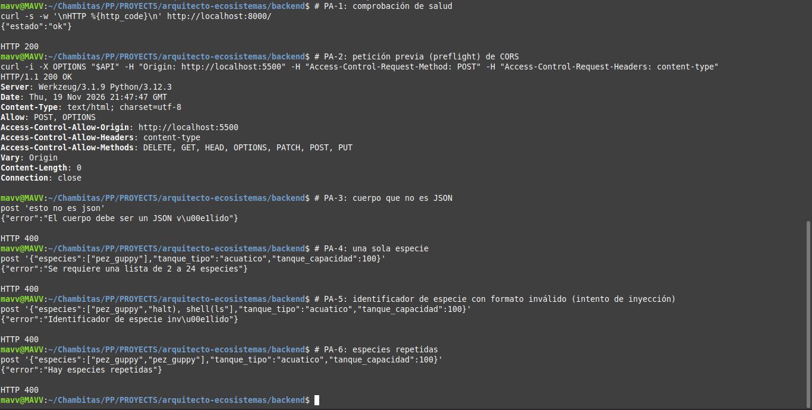

>
> **Evidencia (Pruebas API):**  
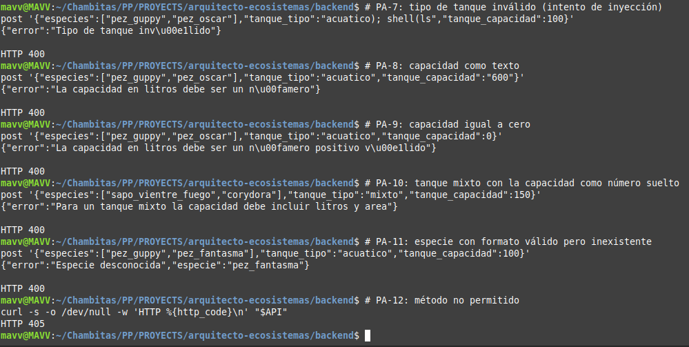

## Notas

* Estos casos validan la **lógica del sistema sobre los datos de la base de conocimientos**. No sustituyen el criterio de un acuaterariófilo experto.
* Los casos 2 y 3 salen viables según los parámetros de los hechos, pero en la práctica se desaconseja mezclar anfibios con reptiles o con peces en un mismo recinto debido a las toxinas cutáneas, patógenos y estrés. Esto se debe a que el proyecto tiene limitaciones: solo considera temperatura, pH, humedad, espacio, tamaño y temperamento.
* Cada caso aísla **un solo motivo de rechazo** para que, si una prueba falla, sea fácil identificar qué parte de las reglas la causó. La excepción es el caso 7, que produce dos conflictos relacionados (hábitat y humedad) porque una especie desértica y una tropical difieren en ambos.
* Las dimensiones del tanque son ejemplos, lo que importa para la prueba es la capacidad en la unidad de cada hábitat: litros en acuarios, cm² en terrarios y ambos valores en paludarios.
* El servidor valida los datos antes de invocar a Prolog (pruebas PA-3 a PA-11) y nunca ejecuta texto recibido del navegador, de modo que las entradas incorrectas se rechazan con HTTP 400.
* Los valores de capacidad de los casos son múltiplos de los pasos de los deslizadores de la interfaz (10 L y 100 cm²), por lo que se pueden fijar con exactitud.

</div>